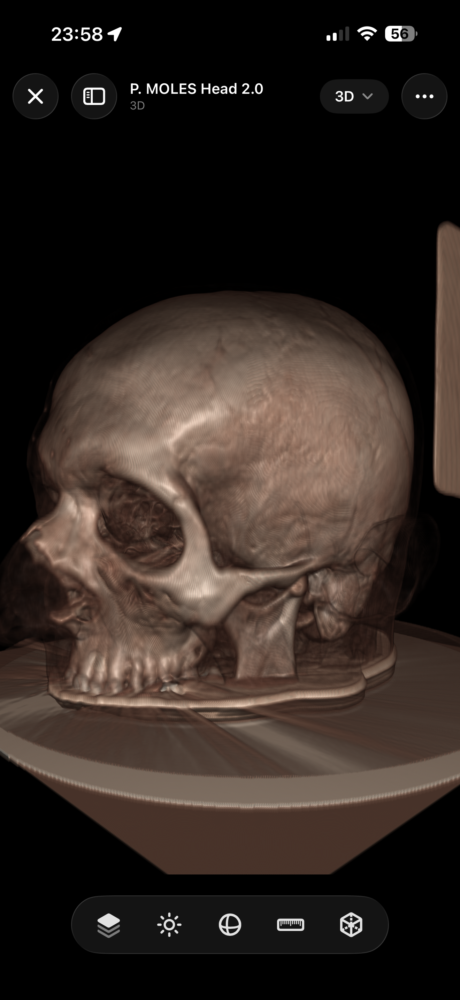
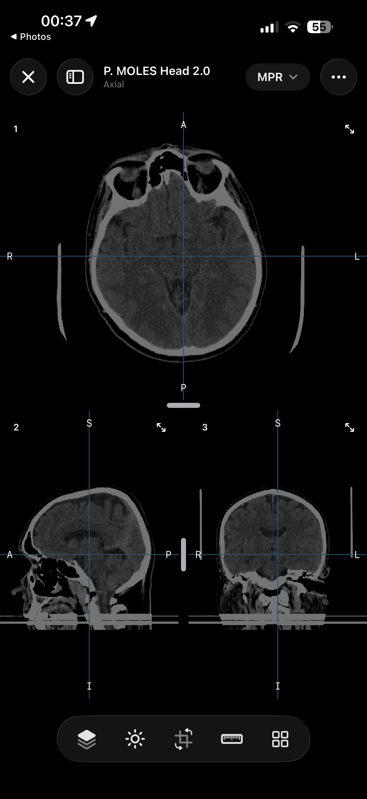

# MTK — Metal Toolkit for volumetric rendering


Core-only Swift package for Metal-native volume rendering. Metal is the only
official clinical renderer. Interactive clinical frames are `MTLTexture`
outputs that a downstream application may present through `MTKView` or
`CAMetalLayer`; `CGImage` is allowed only for explicit export, snapshot, debug,
and test readback use cases behind
`SnapshotExporting`/`TextureSnapshotExporter`.

<table align="center">
  <tr>
    <td align="center"><b>3D Volume Rendering</b></td>
    <td align="center"><b>MPR View</b></td>
  </tr>
  <tr>
    <td></td>
    <td></td>
  </tr>
</table>

## Package layout
- `MTKCore` — Domain types (`VolumeDataset`, orientation/spacing models), Metal helpers (`MetalVolumeRenderingAdapter`, `VolumeTextureFactory`, `ShaderLibraryLoader`), serializable clinical transfer function models (`TransferFunction`, `ClinicalTransferFunctionPreset`, `AdvancedToneCurveModel`, `VolumeTransferFunctionLibrary`), and runtime availability guards. MTKCore does not parse DICOM.
- `MTKFixtures` — Optional synthetic datasets generated by code. The public package does not ship `.raw.zip` fixture presets.

The package intentionally ships no SwiftUI/UIKit/AppKit product, viewport,
gesture layer, overlay, or example application. The complete reference app and
integration examples live in
[MTK-Demo](https://github.com/ThalesMMS/MTK-Demo).

## Related repositories
- [MTK](https://github.com/ThalesMMS/MTK) — Metal rendering core and synthetic fixtures.
- [DICOM-Swift](https://github.com/ThalesMMS/DICOM-Swift) — Swift DICOM parsing, ZIP loading, metadata extraction, and decoded series assembly.
- [MTKDicomBridge](https://github.com/ThalesMMS/MTKDicomBridge) — Separate SwiftPM package that converts `DicomCore.DicomDecodedSeries` into MTK `VolumeDataset` values.
- [MTK-Demo](https://github.com/ThalesMMS/MTK-Demo) — Public demo app that consumes MTK, MTKDicomBridge, and DICOM-Swift by release tag.

## Architecture
The public API contract is documented in [Architecture/PublicAPI.md](Architecture/PublicAPI.md). The accepted core-only boundary is documented in [Architecture/HeadlessArchitectureADR.md](Architecture/HeadlessArchitectureADR.md); [Architecture/ClinicalRenderingADR.md](Architecture/ClinicalRenderingADR.md) is retained as historical context. Multi-volume registration and resampling follow the staged plan in [Architecture/MultiVolumeRegistration.md](Architecture/MultiVolumeRegistration.md).

```text
DICOM / VolumeDataset
        |
        v
VolumeResourceManager
        |
        v
GPU volume texture / transfer texture / auxiliary textures
        |
        v
MTKRenderingEngine
        |
        v
ViewportRenderGraph
        |
        v
VolumeRaycastPass / MPRReslicePass / MIPPass / OverlayPass
        |
        v
PresentationPass
        |
        v
MTKView / CAMetalLayer drawable
```

Metal-native rendering is the only official clinical backend. The target interactive presentation surface is `MTKView`/`CAMetalLayer`, with `MTLTexture` as the frame result handed to the presentation pass. Viewports are expected to share GPU resources through handles owned by a resource manager, so synchronized volume, MPR, projection, and overlay views consume the same volume textures, transfer textures, and auxiliary textures instead of duplicating them per surface.

Volume data remains in the shared `r16Sint` or `r16Uint` texture used by MPR, histogram, and empty-space pipelines. The volume raycast pass binds a cached `r16Snorm` or `r16Unorm` pixel-format view of that same allocation so the GPU can perform trilinear filtering with one hardware sample; shader decoding restores the signed or unsigned clinical intensity domain and preserves `Int16.min` as the signed padding sentinel. Because signed-normalized encoding aliases `-32768` and `-32767`, the renderer reserves the former sentinel and treats the latter as that sentinel in the signed raycast view.

Bounding geometry can be a valid internal implementation detail for ray entry and ray exit inside a specialized pass. It does not change the public clinical rendering architecture.

MTKCore provides `PresentationPass` and `MPRPresentationPass` for encoding a
completed `MTLTexture` into a caller-supplied drawable without `CGImage`
conversion. The application owns the platform view, drawable lifecycle,
gestures, overlays, synchronization, and product workflow. Render-graph,
resource-manager, pass-node, and output-pool internals are not the recommended
external API.

## Volume input boundary
MTKCore owns the renderer-ready volume DTOs used at the package boundary: `VolumetricDimensions`,
`VolumetricSpacing`, `VolumetricOrientation`, `VolumetricPixelFormat`, `VolumetricSeriesData`, and
`VolumetricSeriesDataProvider`. App-side loaders that use GDCM, DICOM-Swift, or custom ingestion keep responsibility
for DICOM parsing, PHI handling, decompression, slice ordering, rescale, and window metadata, then hand MTKCore a
decoded scalar volume through `VolumetricSeriesData`, a provider adapter, or a manually constructed `VolumeDataset`.
The main rendering path does not require `MTKDicomBridge`.

## Segmentation surfaces
MTKCore exposes a `SurfaceMesh` contract with vertices, normals, indices, coordinate space, bounds, and segment metadata. `MarchingCubesExtractor` provides deterministic CPU extraction from `LabelmapVolume` labels or scalar `VolumeDataset` thresholds. Extracted labelmap meshes carry the same label/segment id that MPR labelmap overlays use. Extracted meshes default to `.worldMillimeters` coordinates through the source volume affine; `.textureNormalized` is available for callers that need texture-space geometry.

`MTKDicomBridge` can convert parsed DICOM SEG objects into `VolumeLayer` labelmaps aligned to a base `VolumeDataset`, preserving segment labels for MPR and 3D overlay review.

The render path is `labelmap 3D -> SurfaceMesh -> SurfaceMeshLayer -> volume3D viewport`. `SurfaceMeshProcessor` provides deterministic CPU topology repair, Laplacian smoothing, and ratio-based triangle decimation before rendering. `SurfaceMeshMaterial` carries clinical, matte, glossy, and unlit shading defaults, and `MetalSurfaceMeshRenderer` draws indexed triangles into the existing Metal output texture after volume raycasting. Opaque surfaces write mesh-local depth first, semi-transparent surfaces render afterward with stable layer-level back-to-front ordering, and volume crop/clip settings are applied to the surface fragments. True raycast-volume depth occlusion and GPU extraction remain explicit follow-ups because the raycast pass does not yet publish a reusable depth texture.

## Multi-volume fusion
MTKCore supports v1 scalar volume fusion for registered layer stacks. `VolumeLayer` can carry scalar volume content with its own `VolumeDataset`, `VolumeTransferFunction`, opacity, visibility, and blend mode. `VolumeLayerBlendMode.sourceOver` is the default alpha-over mode, and `.additive` is available for PET-like heat or dose overlays.

The existing single-volume `VolumeRenderRequest(dataset:transferFunction:...)` path remains source-compatible. Multi-layer rendering keeps the one-layer fast path; additional visible scalar layers are raycast separately and composited through a Metal pass, so cost scales with the number of visible scalar layers. Package-internal resource management shares layer resources by handle and reports layer memory in GPU resource metrics.

MTK does not implement automatic or deformable registration. Scalar layers can be supplied either pre-resampled into the base volume texture space or with an externally supplied axis-aligned scale/translation `baseWorldToLayerWorld` transform. Supported registered scalar overlays are CPU-resampled into the base geometry before the 3D fusion fast path; unsupported affine, rotation, shear, perspective, and non-finite transforms fail with a structured error. Labelmap/MPR affine overlay support remains unchanged. The registration and resampling contract is documented in [Architecture/MultiVolumeRegistration.md](Architecture/MultiVolumeRegistration.md).

## Requirements
- Swift 6 toolchain (Swift 5 language mode), Xcode 26
- iOS 26+ / visionOS 26+ / macOS 26+
- Metal-capable device required for rendering and GPU test coverage. Metal is the runtime contract for rendering; no alternate rendering runtime is provided. GPU-dependent tests require Metal and skip when unavailable.
- Metal Performance Shaders behavior is feature-specific and should be treated as an explicit capability/result contract:
  - Volume rendering (`MetalVolumeRenderingAdapter`): Pure Metal ray marching remains the required fallback on every supported Metal device.
  - Empty-space acceleration (`MPSEmptySpaceAccelerator`): On MPS-capable devices, the production adapter builds and
    caches one min/max structure for the active DVR dataset, binds it at argument index 19, and enables option bit 4.
    Unsupported devices, generation failures, and projection modes use the baseline raymarch path. Shared helpers
    return `.success`, `.unavailable(reason:)`, or `.failed(error)` instead of `nil`.
  - Histogram calculation (`VolumeHistogramCalculator`): Pure Metal compute. No MPS dependency.
  - Statistics calculation (`VolumeStatisticsCalculator`): Metal compute with explicit GPU setup and execution errors. CPU reference implementations exist only in tests.

## Intended use and safety
MTK is a rendering toolkit for research, education, and prototype applications involving volumetric medical-image data on Apple platforms. It is **not** a medical device, has **not** been validated for clinical decision-making, and should not be the sole basis for diagnosis, treatment, or patient triage.

If you load real DICOM studies, keep PHI handling, local security, and institutional review requirements in mind. The repository demonstrates rendering infrastructure and loading patterns; it does not claim regulatory clearance, dataset-wide clinical validation, or diagnostic performance.

## Add via Swift Package Manager
Point Xcode or SwiftPM at the MTK Git repository and depend on the library products you need:

```swift
.package(url: "https://github.com/ThalesMMS/MTK.git", exact: "1.5.0"),
.target(
    name: "YourApp",
    dependencies: [
        .product(name: "MTKCore", package: "MTK")
    ]
)
```

`MTKDicomBridge` is published as a separate package, not as an MTK product. Add it only when the app wants MTK's default Swift DICOM parser:

```swift
.package(url: "https://github.com/ThalesMMS/MTK.git", exact: "1.5.0"),
.package(url: "https://github.com/ThalesMMS/MTKDicomBridge.git", exact: "1.1.0"),
.target(
    name: "YourApp",
    dependencies: [
        .product(name: "MTKCore", package: "MTK"),
        .product(name: "MTKDicomBridge", package: "MTKDicomBridge")
    ]
)
```

SceneKit examples may be extracted to a separate experimental package in the future, but they are not part of the main package contract.

### Migration map for former MTKSceneKit consumers
- Replace `MTKSceneKit` volume presentation (`VolumeCubeMaterial`) with `MetalVolumeRenderingAdapter`, then present its `MTLTexture` output in an application-owned Metal surface.
- Replace `MTKSceneKit` MPR presentation (`MPRPlaneMaterial`) with `MetalMPRAdapter` and an application-owned synchronized layout.
- Keep camera interaction, gestures, overlays, and layout state in the downstream app.
- Replace node/plane helper usage (`SCNNode+Volumetric`) with geometry and display helpers that stay in the Metal-native path, such as `MPRPlaneGeometryFactory` and `MPRDisplayTransformFactory`.
- If you still need a standalone 3D wrapper for non-clinical experiments, keep that code outside the main package. There is no maintained `SceneKitExamples` package in this repository today.

Recommended vs Legacy:
- Recommended: `MetalVolumeRenderingAdapter` + app-owned Metal presentation / Legacy: deprecated `VolumeCubeMaterial`
- Recommended: `MetalMPRAdapter` + app-owned layout / Legacy: deprecated `MPRPlaneMaterial`
- Recommended: app-owned interaction state / Legacy: deprecated `VolumeCameraController`, `CameraPose`, `SCNNode+Volumetric`

Compatibility note:
- The current MTK package requires iOS 26+, visionOS 26+, and macOS 26+. Downstream apps that still need older platform support or a custom 3D wrapper should keep that compatibility layer outside this package.
- Example code for the supported migration path lives in the separate [MTK-Demo](https://github.com/ThalesMMS/MTK-Demo) repository.

## Shaders and resources
- `ShaderLibraryLoader` requires `MTK.metallib` to be bundled in `Bundle.module`. Missing or invalid artifacts are reported as structured `ShaderLibraryLoader.LoaderError` cases, such as `metallibNotBundled` or `metallibLoadFailed(underlying:)`.
- Precompiled Metal libraries are versioned under `Sources/MTKCore/Resources` so downstream Xcode projects build without shader-generation trust prompts.
- Manual shader rebuild is only needed after changing `.metal` sources: `MTK_METAL_SDK=all METALLIB_STRICT=1 bash Tooling/Shaders/build_metallib.sh Sources/MTKCore/Resources/Shaders Sources/MTKCore/Resources/MTK.metallib`
- Troubleshooting: if shader loading fails, verify that `MTK.metallib`, `MTK-iphonesimulator.metallib`, and `MTK-iphoneos.metallib` are present in the `MTKCore` resource bundle.
- Public `.raw.zip` presets are not bundled. Use `ClinicalSyntheticFixtures` in `MTKFixtures` for sample volumes; `VolumeTextureFactory(preset:)` is deprecated and kept only for compatibility.
- Preset loading now reports `noDataAvailable`; it does not silently return a stub volume.
- Use `VolumeTextureFactory.debugPlaceholderDataset()` only for tests or explicit debug tooling that needs a minimal 1x1x1 volume.

## Quick start

Construct a renderer-ready dataset and hand it to the Metal adapter. UI and
drawable ownership remain in the host application:

```swift
import MTKCore

let voxelCount = 256 * 256 * 128
let voxels = Data(repeating: 0,
                  count: voxelCount * VolumePixelFormat.int16Signed.bytesPerVoxel)
let dataset = VolumeDataset(
    data: voxels,
    dimensions: VolumeDimensions(width: 256, height: 256, depth: 128),
    spacing: VolumeSpacing(x: 1.0, y: 1.0, z: 1.5),
    pixelFormat: .int16Signed,
    intensityRange: (-1024)...3071
)

let renderer = try MetalVolumeRenderingAdapter()
// Build a VolumeRenderRequest for the host application's viewport, then call:
let frame = try await renderer.renderFrame(using: request)
let texture = frame.texture
```

See MTK-Demo for the complete app-owned SwiftUI and Metal presentation flow.

## Clinical transfer functions
`TransferFunction` is the public JSON contract for clinical presets and user edits. Version 1 keeps existing `.tf` keys (`name`, `min`, `max`, `colourPoints`, `alphaPoints`, `shift`, `colorSpace`) and adds optional `metadata`, `renderingIntent`, and `gradientOpacity` fields. RGB color is represented by `colourPoints`; opacity is represented by the piecewise `alphaPoints` function. `colourValue.a` remains round-tripped for compatibility but does not replace `alphaPoints`.

```swift
let preset = try ClinicalTransferFunctionPreset.ctVRBone.loadTransferFunction()
let data = try JSONEncoder().encode(preset)
let restored = try JSONDecoder().decode(TransferFunction.self, from: data)
let volumeTransferFunction = restored.volumeTransferFunction()
```

When `gradientOpacity` is present, MTK builds a 2D transfer texture and multiplies scalar opacity by gradient magnitude during DVR. Presets without `gradientOpacity` keep the legacy 1D transfer-texture path.

## Loading DICOM volumes
`DICOM-Swift` owns DICOM source loading, ZIP extraction, slice ordering, geometry validation, rescale slope/intercept, recommended window metadata, and DICOM errors. Use `MTKCore` alone when your app already has a `VolumeDataset`. Import `MTKDicomBridge` when you want to convert the default `DICOM-Swift` result into a renderer-ready dataset:

```swift
import MTKCore
import MTKDicomBridge

let importer = DicomVolumeDatasetImporter()
importer.loadDataset(from: sourceURL, progress: { _ in }) { result in
    let dataset = try? result.get().dataset
    _ = dataset
}
```

Progress and failures are surfaced from `DicomCore`; the bridge does not remap DICOM parser errors into MTKCore-specific error cases.

## Expected inputs and outputs
**Typical inputs**
- A synthetic or programmatically generated voxel buffer wrapped in `VolumeDataset`
- A DICOM directory, ZIP archive, or individual file routed through `DICOM-Swift` and converted by `MTKDicomBridge`
- 16-bit scalar volume data with spatial metadata available for reconstruction

**Typical outputs**
- An in-memory `VolumeDataset` ready for rendering
- `DicomVolumeDatasetImportResult` metadata such as `sourceURL` and `seriesDescription`
- Interactive `MTLTexture` frame outputs for drawable-backed presentation
- Renderer-owned `MTLTexture` outputs ready for application-owned presentation

MTK does **not** produce segmentation masks, classification labels, radiology reports, or treatment recommendations by itself. In other words, the package is a visualization/loading substrate, not a diagnostic model.

## Runtime checks and diagnostics
- `BackendResolver` and `MetalRuntimeAvailability` enforce the Metal rendering requirement before controllers are created. `ensureAvailability()` throws explicit availability errors, and `status()` exposes structured diagnostics plus optional MPS capability flags.
- `MetalRuntimeGuard` exposes structured requirement status, missing required capabilities, and optional MPS feature availability for diagnostics.
- `CommandBufferProfiler` and `VolumeRenderingDebugOptions` help surface GPU runtime behavior during development.

```swift
func validateRenderingRuntime() throws {
    try MetalRuntimeAvailability.ensureAvailability()
    let status = MetalRuntimeAvailability.status()
    print("MPS available: \(status.supportsMetalPerformanceShaders)")
}

do {
    try validateRenderingRuntime()
} catch {
    let status = MetalRuntimeAvailability.status()
    print("Metal requirement failed: \(status.missingFeatures)")
    print("MPS available: \(status.supportsMetalPerformanceShaders)")
}
```

## Testing notes
- `swift test` requires a Metal-capable host for GPU-dependent suites; those tests require Metal and skip when unavailable.
- Hardware or OS capability skips are expected for unavailable Metal, unavailable MPS features, and iOS-only gesture
  overlay coverage when the suite runs on macOS.
- Clinical performance budget coverage uses the committed manifest at
  `Roadmap/ClinicalPerformanceBudgetManifest.json`. The clinical reporter emits
  JSON, CSV, and Markdown with per-stage p50/p95/p99, work/resource counters,
  correctness, baseline delta, and verdict. Results must match every environment
  key listed there before relative comparisons are treated as clinical-rendering evidence.
- DICOM geometry tests commit small non-PHI manifest fixtures. Large real DICOM series remain optional local fixtures
  and are intentionally skipped when unavailable.
- The standalone `VolumeRendererComparison` benchmark requires an explicit local DICOM path through `--dicom`. If you want to use the sample data from the demo project, clone or download fixtures from `https://github.com/ThalesMMS/MTK-Demo.git` and pass the local path explicitly.
- DICOM source security coverage lives in `DICOM-Swift`; visual-quality checks compare MPS-accelerated empty-space skipping (feature availability requires MPS) against core Metal ray marching on synthetic datasets.

## Limitations and evaluation caveats
- The package targets Apple-platform rendering workflows; it is not a cross-platform PACS, archive, or viewer.
- Tests mostly exercise synthetic datasets, renderer behaviors, and optional local fixtures rather than a versioned benchmark corpus committed in this repository. Application examples live in MTK-Demo.
- Rendering correctness checks and visual-regression tests are useful engineering signals, but they are **not** the same thing as clinical validation or reader-study evidence.
- DICOM import support depends on `DICOM-Swift` metadata coverage and input quality. Unsupported transfer syntaxes, malformed datasets, geometry failures, unsupported scalar formats, empty sources, and unsafe ZIP entries surface as `DicomCore` errors.

## Documentation

DocC documentation covers `MTKCore` with API reference, conceptual guides, and
a GPU-texture-focused Getting Started tutorial. The accepted package boundary
lives in `Architecture/HeadlessArchitectureADR.md`. Runnable application and
UI examples live in MTK-Demo.

Generate documentation locally:

```bash
bash Tooling/build_docs.sh
```

This creates `.doccarchive` files in the `docs/` directory that can be opened in Xcode or hosted as static HTML.

## License
Apache 2.0. See `LICENSE`.
